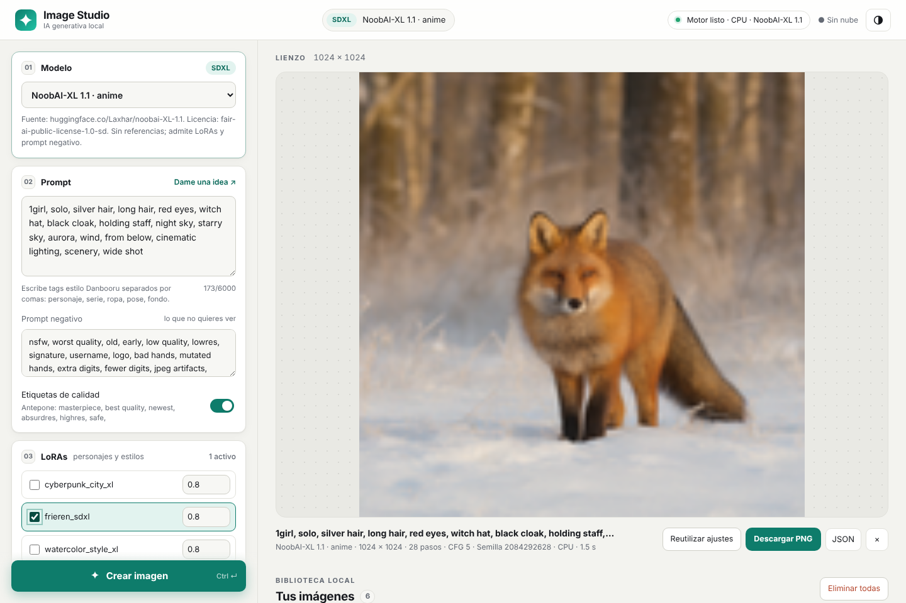
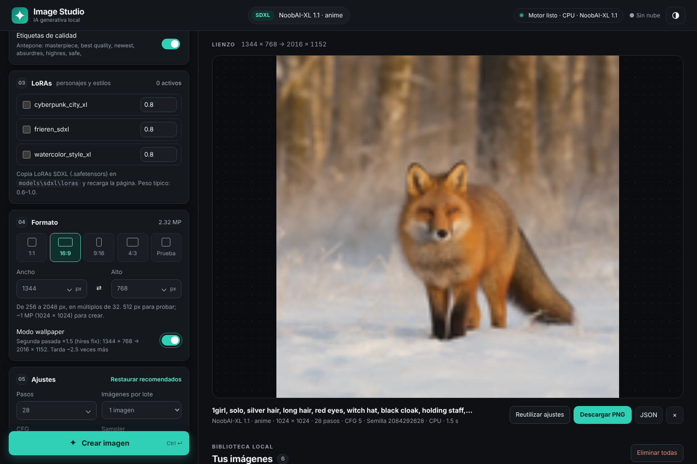
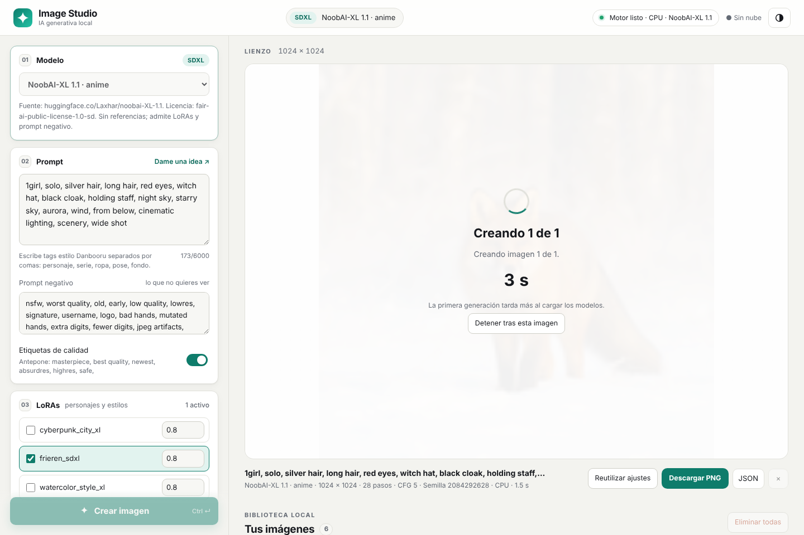
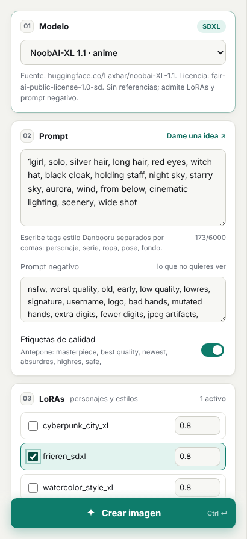
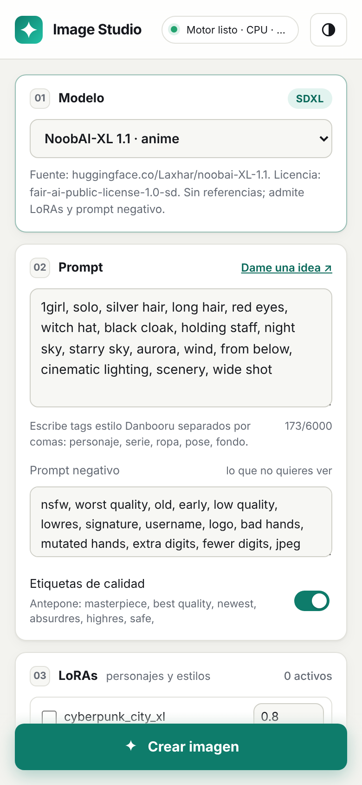

# Image Studio

**Genera imágenes con IA en tu propio PC, con CPU, GPU o ambas.** Estudio web local en español para modelos de difusión abiertos:
- **SDXL** (NoobAI-XL, Illustrious, Pony, Animagine o tus propios checkpoints), con LoRAs y modo wallpaper, desde GPUs de **4–6 GB**;
- **Qwen-Image 2.1 + Viggle Turbo**, para instrucciones en lenguaje natural y edición con referencias en GPUs de 8 GB.

Sin cuentas, sin créditos y sin enviar nada a la nube.



## Características

- **Varios modelos, una interfaz.** Elige el modelo en el selector y la interfaz muestra sus controles y ajustes recomendados. Cualquier checkpoint SDXL que copies en `models\sdxl\checkpoints` aparece solo.
- **SDXL:**
  - prompt negativo, CFG, sampler, etiquetas de calidad;
  - hasta **4 LoRAs** combinados (personajes, estilos);
  - **modo wallpaper** con segunda pasada ×1.5 (1344 × 768 → 2016 × 1152).
- **Qwen-Image:** texto en lenguaje natural, texto dentro de la imagen y **edición con hasta 2 referencias**. Turbo hace 1024 × 1024 en ~18 s con 8 GB.
- **CPU, GPU NVIDIA (CUDA), GPU AMD/Intel (Vulkan) o CPU + GPU.** El modo automático elige lo más rápido. Los pesos esperan en RAM y pasan a la VRAM por bloques, así que caben modelos más grandes que tu tarjeta.
- **Todo local y privado:** Internet solo se usa durante la instalación.
- **Biblioteca local:** cada imagen con todos sus parámetros (PNG + JSON). Puedes reutilizar ajustes, descargar y borrar con papelera.
- Instalador que **descarga y verifica** (SHA256) motores, modelos, Node.js y el runtime de Visual C++.
- Tema claro y oscuro (sigue al sistema) e interfaz adaptada a móvil.

## Capturas

| Tema oscuro · modo wallpaper | Generando |
| --- | --- |
|  |  |

| Modelo, prompt y LoRAs | Móvil |
| --- | --- |
|  |  |

<sub>Las capturas usan una imagen de muestra en el lienzo y la biblioteca.</sub>

## ¿Qué modelo instalo?

| Tu equipo | Recomendado | Descarga |
| --- | --- | ---: |
| GPU de 4–6 GB (GTX 1060/1650, RTX 2060/3050…), o solo CPU | **NoobAI-XL 1.1** (anime) u otro SDXL | 7 GB |
| GPU de 8 GB o más | Ambos: SDXL para anime y LoRAs, Qwen para instrucciones y edición | 24 GB |
| Portátil con GPU integrada | SDXL en modo CPU + GPU, empezando por 768 × 768 | 7 GB |

Por qué SDXL cabe donde Qwen no: [docs/MODELOS.md](docs/MODELOS.md#1-conceptos-en-dos-minutos).

## Requisitos

| | Mínimo | Recomendado |
| --- | --- | --- |
| Sistema | Windows 10 u 11 de 64 bits | Windows 11 |
| RAM | 16 GB (cierra otras aplicaciones pesadas) | 32 GB |
| Disco libre | 9 GB (solo SDXL) · 25 GB (Qwen) | SSD |
| GPU | Opcional | NVIDIA de 6 GB o más (SDXL) · 8 GB (Qwen) |
| Internet | Solo para instalar | — |

No necesitas Python, CUDA ni ninguna otra herramienta. Basta con el controlador de tu GPU actualizado: NVIDIA, o AMD/Intel con soporte Vulkan.

## Instalación

1. **Descarga la app.** **Code → Download ZIP** y descomprímela en una carpeta con espacio, por ejemplo `D:\Programas\image-studio`. Evita carpetas de OneDrive: los modelos pesan varios GB. También puedes clonarla:
   ```powershell
   git clone https://github.com/BrandonAlvarez1220/image-studio.git
   ```
2. **Ejecuta `Instalar Image Studio.cmd`** y elige en el menú:
   ```
   1) Anime SDXL: NoobAI-XL 1.1  (descarga de 7 GB, GPU de 4-6 GB o CPU)
   2) Qwen-Image 2.1 + Viggle Turbo  (descarga de 17 GB, GPU de 8 GB o mas)
   3) Ambos
   ```
   - Si Windows muestra *«Windows protegió su PC»*: **Más información → Ejecutar de todas formas**.
   - Atajos: **`Instalar modelo anime (NoobAI-XL).cmd`** (opción 1 sin preguntar) e **`Instalar solo CPU.cmd`** (sin motores de GPU).
   - Si se corta Internet, vuelve a ejecutarlo: reanuda las descargas y verifica cada archivo.
3. **Abre `Iniciar Image Studio.cmd`.** Se abre http://127.0.0.1:7871 y el modelo se carga en segundo plano mientras escribes.
4. **Para cerrar, usa `Detener Image Studio.cmd`.** Libera la memoria. Tus imágenes quedan en `outputs\`.

Qué descarga cada paso, parámetros del instalador y cómo añadir modelos: [docs/MODELOS.md](docs/MODELOS.md#3-instalar-un-modelo-del-catálogo).

## Cómo crear una imagen

### Con un modelo SDXL (anime, ilustración)

1. **01 · Modelo:** elige NoobAI-XL u otro checkpoint.
2. **02 · Prompt:** escribe **tags separados por comas**, al estilo Danbooru: `1girl, solo, frieren, sousou no frieren, white hair, elf, scenery, sunset`.
   - NoobAI e Illustrious reconocen muchos personajes por su tag, sin LoRA.
   - El prompt negativo indica lo que se quiere evitar.
   - «Etiquetas de calidad» antepone las que recomienda el modelo.
3. **03 · LoRAs:** marca los que quieras (personajes o estilos de `models\sdxl\loras`) y ajusta el peso (0,6–1,0). Si la ficha del LoRA indica una *trigger word*, escríbela en el prompt.
4. **04 · Formato:** 1:1, 16:9 o 9:16 a ~1 MP. Para **wallpapers**, 16:9 + **Modo wallpaper**.
5. **05 · Ajustes:** 28 pasos, CFG 5 y Euler a por defecto (**Restaurar recomendados** los repone). CFG mide cuánto se fuerza el prompt: muy alto quema colores, muy bajo ignora tags.

### Con Qwen-Image

Escribe en español o inglés, en frases completas. Opcionalmente añade **hasta 2 referencias** y menciónalas como «imagen 1» e «imagen 2» para editarlas o combinarlas. Deja **6 pasos** (configuración Turbo).

En ambos casos:
- La **semilla** −1 es aleatoria; la misma semilla y los mismos ajustes repiten la imagen.
- Pulsa **Crear imagen** o `Ctrl + Enter`.
- Puedes cerrar la pestaña: la generación sigue y la web la recupera al volver.

## CPU, GPU o ambas

En **06 · Equipo → Procesamiento**:

| Modo | Cuándo usarlo |
| --- | --- |
| **Automático** | Recomendado. GPU si hay tarjeta dedicada, CPU + GPU si solo hay GPU integrada, CPU si no hay GPU compatible. |
| **GPU** | Tarjeta dedicada NVIDIA (CUDA) o AMD/Intel (Vulkan). Lo más rápido. |
| **CPU + GPU** | GPU integrada o con poca VRAM: el texto se procesa en la CPU y la imagen en la GPU. |
| **CPU** | Equipos sin GPU. Funciona, pero tarda minutos por imagen: empieza con 512 × 512. |

**Atención rápida** (SageAttention) solo aparece con NVIDIA **RTX 30 o posterior** y Qwen-Image: ~12 % más rápido, con detalles finos ligeramente distintos.

Rendimiento medido de Qwen-Image (RTX 4070 Laptop 8 GB, 6 pasos): 1024 × 1024 en 17–18 s; 512 × 512 en 4,4 s. Detalles en [docs/QWEN-IMAGE.md](docs/QWEN-IMAGE.md).

## Documentación

| Documento | Contenido |
| --- | --- |
| [docs/MODELOS.md](docs/MODELOS.md) | Conceptos (codificador, difusión, VAE). Familias soportadas, instalar y registrar checkpoints, dónde descargar, verificar hashes, LoRAs, cuantización GGUF, licencias |
| [docs/MOTOR.md](docs/MOTOR.md) | Ejecutables (`sd-server.exe`, `sd-cli.exe`), runtimes CPU/CUDA/Vulkan, argumentos por modelo, uso manual del motor, puertos, variables, registros, actualizar el motor |
| [docs/ARQUITECTURA.md](docs/ARQUITECTURA.md) | Módulos, ciclo de una imagen, API de la app, cómo añadir una familia nueva (FLUX, SD 1.5…), pruebas y convenciones |
| [docs/QWEN-IMAGE.md](docs/QWEN-IMAGE.md) | Qwen-Image 2.1 + Viggle Turbo: optimizaciones medidas, LoRA fusionado, planificador Turbo |

## Solución de problemas

| Síntoma | Solución |
| --- | --- |
| «Descarga interrumpida» durante la instalación | Vuelve a ejecutar el instalador: reanuda la descarga. |
| «Falta … Ejecuta Instalar Image Studio.cmd» al iniciar | No hay ningún modelo completo instalado; ejecuta de nuevo el instalador. |
| «La GPU no tuvo memoria suficiente» | Usa un tamaño menor o el modo **CPU + GPU**, desactiva el modo wallpaper y cierra otros programas que usen la GPU. |
| «No quedó suficiente memoria RAM» | Cierra aplicaciones pesadas, reduce el tamaño o usa un checkpoint cuantizado ([MODELOS.md §7](docs/MODELOS.md#7-memoria-cuantización-y-gguf)). |
| El motor no inicia con una GTX 10xx/16xx o RTX 20xx | Actualiza la app: SageAttention requiere RTX 30+ y ahora solo se activa en esas GPUs. |
| No aparece mi checkpoint o LoRA | Debe ser `.safetensors` o `.gguf`, sin caracteres especiales en el nombre, en `models\sdxl\checkpoints` o `models\sdxl\loras`. Recarga la página. |
| Imágenes deformes o «quemadas» con un LoRA | Baja su peso (0,6–0,8) o el CFG, y comprueba que el LoRA sea para SDXL y no para SD 1.5 o Flux. |
| No aparece mi GPU | Actualiza el controlador y vuelve a abrir la app. |
| El puerto 7871 está ocupado | Cierra la otra instancia con `Detener Image Studio.cmd`. |

Los registros están en `logs\` (qué contiene cada uno: [MOTOR.md §6](docs/MOTOR.md#6-puertos-variables-y-registros)).

## Actualizar o desinstalar

- **Actualizar:** descarga la nueva versión encima de la carpeta (o `git pull`) y ejecuta de nuevo el instalador. Solo descarga lo que falte.
- **Desinstalar:** ejecuta `Detener Image Studio.cmd` y borra la carpeta. Guarda antes `outputs\` si quieres conservar tus imágenes. La app no escribe fuera de su carpeta, salvo el runtime de Visual C++ si lo instaló.

## Estructura del proyecto

```
app/                  Interfaz web (HTML, CSS y JavaScript sin dependencias)
scripts/              Servidor Node, catálogo de modelos, gestor del motor, instalador y pruebas
docs/                 Guías (modelos, motor, arquitectura, Qwen-Image) y capturas
qa/optimizacion/      Mediciones usadas para elegir la configuración del motor
models/               Licencias de los modelos (los pesos los descarga el instalador)
model-config.json     Qwen-Image: versiones, revisiones y hashes fijados
sdxl-models.json      Catálogo SDXL: checkpoints conocidos y sus ajustes recomendados
*.cmd                 Instalar, iniciar y detener con doble clic
```

Carpetas creadas por el instalador y la app (no forman parte del repositorio): `models\` (pesos), `runtime-*` (motores), `node\`, `outputs\`, `logs\` y `.downloads\`.

## Licencias y créditos

- **Origen:** Image Studio parte de [Qwen Imagen Studio](https://github.com/jceronch1/qwen-imagen-studio) de jceronch1 (motor gestionado, instalador, biblioteca y optimizaciones de Qwen-Image). Se amplió a varios modelos y se rediseñó la interfaz.
- **Código de la app:** licencia [MIT](LICENSE). Puedes usarlo, modificarlo y redistribuirlo, también con fines comerciales, conservando el aviso de copyright. Cubre solo el código, no los modelos.
- **Modelos:** cada uno conserva su licencia ([docs/MODELOS.md §8](docs/MODELOS.md#8-licencias-y-uso-responsable)).
  - **NoobAI-XL:** *Fair AI Public License 1.0-SD* ([ficha](https://huggingface.co/Laxhar/noobai-XL-1.1)).
  - **Qwen-Image 2.1 y el LoRA Viggle Turbo:** **Qwen RESEARCH LICENSE AGREEMENT**, solo **uso no comercial** (investigación o evaluación). Texto en [models/LICENSE-Viggle.txt](models/LICENSE-Viggle.txt) y aviso en [models/NOTICE-Viggle.txt](models/NOTICE-Viggle.txt). *Qwen is licensed under the Qwen RESEARCH LICENSE AGREEMENT, Copyright (c) 2026 Hangzhou Tongyi Laboratory Technology Co., Ltd. All Rights Reserved.* **Built with Qwen.**
  - El codificador Qwen3-VL y el VAE de Qwen mantienen sus propias licencias ([docs/QWEN-IMAGE.md](docs/QWEN-IMAGE.md#archivos-de-modelos)).
- **Motor de inferencia:** [stable-diffusion.cpp](https://github.com/leejet/stable-diffusion.cpp) de leejet, basado en [ggml](https://github.com/ggml-org/ggml).
- **Aceleración Turbo:** [Viggle](https://huggingface.co/Viggle/Qwen-Image-2.1-viggle-turbo).

Este repositorio contiene solo el código de la app; no redistribuye ningún peso de modelo.
