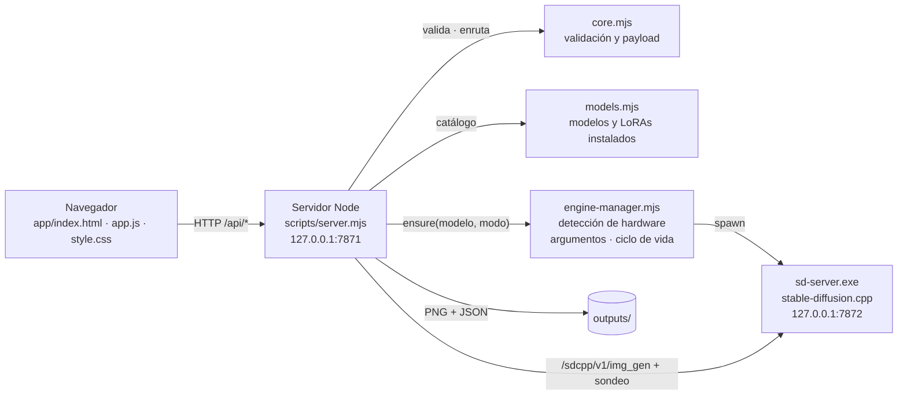

# Arquitectura

Para quien quiera entender o modificar Image Studio. Uso e instalación: [README](../README.md). Modelos: [MODELOS.md](MODELOS.md). Ejecutables y opciones del motor: [MOTOR.md](MOTOR.md). Detalles y mediciones de Qwen-Image: [QWEN-IMAGE.md](QWEN-IMAGE.md).

## Visión general

Principios del diseño:

- **Sin dependencias.** El servidor usa solo módulos de Node (`node:http`, `node:fs`…) y la interfaz es HTML, CSS y JavaScript sin framework ni compilación. No hay `npm install` y el instalador puede traer un Node portable.
- **Un motor, residente.** Cargar un modelo tarda de 10 s a minutos. El motor queda vivo entre imágenes y se precarga al abrir la página.
- **Una imagen por petición al motor.** Un lote de 8 son 8 peticiones con semilla + i. Cada PNG se guarda al terminar, la cancelación ocurre entre imágenes y un fallo no pierde las anteriores.
- **Todo local.** Solo escucha en `127.0.0.1` y comprueba `Host` y `Origin`.

## Módulos

| Archivo | Responsabilidad |
| --- | --- |
| `scripts/models.mjs` | **Catálogo.** Qwen-Image (archivos fijos de `model-config.json`) + cada checkpoint de `models/sdxl/checkpoints`, con los ajustes de `sdxl-models.json`. LoRAs instalados. `presetFor(id)` da los ajustes recomendados de un modelo |
| `scripts/core.mjs` | **Contrato de la petición.** `validate()` normaliza y limita todo lo que llega del navegador. `enginePayload()` / `sdxlPayload()` lo traducen al JSON del motor. Planificador Turbo y política del VAE |
| `scripts/engine-manager.mjs` | **Motor.** Detecta dispositivos (`--list-devices`), elige modo (`chooseMode`), decide opciones (`engineFeatures`, incluida la regla de SageAttention), arma argumentos (`engineArgs` / `sdxlArgs`) y arranca, reutiliza o reinicia `sd-server.exe` con una cola serializada |
| `scripts/server.mjs` | **API HTTP.** Estáticos, trabajos, biblioteca, precarga y estado. Ejecuta los lotes y escribe `outputs/<uuid>.png` + `.json` |
| `scripts/engine-diagnostics.mjs` | Lee las líneas nuevas de `logs/engine.err.log` para distinguir falta de RAM, falta de VRAM y otros fallos |
| `app/app.js` | Estado de la interfaz, formulario por familia (`body.family-sdxl` muestra `.sdxl-only` y oculta `.qwen-only`), LoRAs, biblioteca, sondeo de trabajos y precarga |
| `scripts/install.ps1`, `start.ps1`, `stop.ps1`, `common.ps1` | Ciclo de vida en Windows (PowerShell 5.1, ASCII, CRLF) |
| `scripts/merge-lora.mjs`, `gguf.mjs`, `prepare-lora.mjs` | Solo Qwen: fusión del LoRA Turbo y modo compatible |

## Ciclo de una imagen

1. Al cargar la página, `app.js` pide `/api/models` y rellena el selector con lo instalado. Después llama a `POST /api/engine/warmup` con el modelo y el modo: el motor empieza a cargar mientras escribes.
2. **Crear imagen** → `POST /api/jobs`. El servidor:
   - valida (`core.validate`);
   - comprueba que el modelo y los LoRAs existen (`models.installedModel`);
   - crea el trabajo y responde `202` al instante.
3. `run(job)`:
   - `manager.ensure(compute, threads, fastAttention, model)` reutiliza el motor si la clave `[modelo, modo, dispositivo, hilos, opciones]` no cambió; si cambió, lo reinicia;
   - para cada imagen, `POST /sdcpp/v1/img_gen` y sondeo cada 250 ms.
4. Cada PNG se valida (firma PNG) y se escribe en `outputs/` junto a un JSON con **todos** los parámetros. El JSON se escribe en `.json.tmp` y luego se renombra, para que nunca quede a medias. **Reutilizar ajustes** reconstruye el formulario desde ese JSON.
5. El navegador sondea `GET /api/jobs/{id}` cada 400 ms. Si cierras la pestaña, el trabajo sigue: al volver, `/api/status` informa del trabajo activo y la interfaz lo retoma.

## API de la app

| Método y ruta | Uso |
| --- | --- |
| `GET /api/status` | Motor listo o cargando, hardware detectado, modelo cargado, trabajo activo |
| `GET /api/models` | Modelos instalados, LoRAs, descargas disponibles del catálogo |
| `POST /api/engine/warmup` | Precarga un modelo y un modo (`{model, compute, threads, fastAttention}`) |
| `POST /api/jobs` | Crea un lote (cuerpo abajo) |
| `GET /api/jobs/{id}`, `POST /api/jobs/{id}/cancel` | Estado del lote; detenerlo tras la imagen en curso |
| `GET /api/gallery` | Biblioteca (JSON de cada imagen, más reciente primero) |
| `DELETE /api/gallery`, `/api/gallery/{id}`, `/api/gallery/selection` | Borrar todo, una o varias. Se mueven a `outputs/.trash/` |
| `GET /api/references/{id}` | Referencias usadas por una imagen Qwen |

Cuerpo de `POST /api/jobs` (validado en `core.validate`):

| Campo | Familias | Valores |
| --- | --- | --- |
| `model` | todas | `qwen` o `sdxl:<archivo>` |
| `prompt` | todas | 1–6000 caracteres |
| `width`, `height` | todas | 256–2048, múltiplos de 32 |
| `steps` | todas | 1–40 (Qwen), 1–60 (SDXL) |
| `count`, `seed` | todas | 1–8; −1 = aleatoria |
| `compute`, `threads`, `fastAttention` | todas | `auto`/`cpu`/`gpu`/`hybrid`; 0–128; booleano |
| `refs`, `transparent` | Qwen | Hasta 2 imágenes en data URL; booleano |
| `negativePrompt`, `cfg`, `sampler`, `qualityTags` | SDXL | ≤ 2000 caracteres; 1–15; ver `SAMPLERS` en `models.mjs`; booleano |
| `loras` | SDXL | Hasta 4 `{file, weight}` con peso de −2 a 2 |
| `hires` | SDXL | Modo wallpaper ×1.5; la imagen base debe tener ≤ ~1,5 MP |

## Añadir una familia de modelos

Ejemplo: **FLUX.1** o **SD 1.5**. El motor ya las soporta, así que el trabajo está en la app. El patrón es el mismo que se siguió para SDXL; busca `sdxl` en el código para ver cada punto.

1. **Archivos y catálogo.**
   - Define dónde viven los pesos, por ejemplo `models/flux/`.
   - Define qué archivos necesita cada modelo. FLUX usa `--diffusion-model`, `--clip_l`, `--t5xxl` y `--vae` separados; SD 1.5, un solo archivo como SDXL.
   - Si hay varios checkpoints posibles, crea un catálogo JSON como `sdxl-models.json` y añádelo a `.gitignore` con `!/`.
2. **`models.mjs`.**
   - Un `fluxPreset()` con `family: 'flux'` y los ajustes recomendados (FLUX schnell: 4 pasos, CFG 1, `euler`).
   - Incluirlo en `listModels()` y `presetFor()`.
   - Un prefijo de id nuevo (`flux:`).
3. **`core.mjs`.**
   - En `validate()`, acepta el prefijo y fija los límites propios: qué campos admite, rango de pasos y de CFG.
   - Escribe `fluxPayload()` y enrútalo desde `enginePayload()`.
   - Usa los campos del [`api.md` del motor](https://github.com/leejet/stable-diffusion.cpp/blob/88411ef1e0688ff2df1010aeeb5d92b2d8cea2be/examples/server/api.md) para esa familia. FLUX, por ejemplo, usa `guidance.distilled_guidance`.
4. **`engine-manager.mjs`.**
   - Escribe `fluxArgs()` y enrútalo desde `engineArgs()`.
   - Consulta `docs/<familia>.md` del motor para los archivos y las opciones recomendadas.
   - Decide si la familia puede usar SageAttention (solo se ha medido con Qwen).
5. **`server.mjs`.** Escribe un `fluxRecord()` para el JSON de la biblioteca: qué parámetros hay que guardar para reproducir la imagen.
6. **Interfaz.**
   - En `renderModel()` de `app.js`, la clase de `body` por familia (hoy `family-sdxl`).
   - Las clases `.flux-only` y sus reglas en `style.css`.
   - Textos de ayuda e ideas.
7. **Instalador.** Un valor nuevo en `-Models` y su paso de descarga, con SHA256 fijado o el de Hugging Face (`Get-HfSha256`).
8. **Pruebas.** Copia `scripts/test-sdxl.mjs`. Cubre validación, payload, argumentos y un trabajo de punta a punta con motor simulado.
9. **Documentación.** Añade la familia a la tabla de [MODELOS.md](MODELOS.md#2-familias-que-soporta-la-app) y sus argumentos a [MOTOR.md](MOTOR.md#argumentos-por-familia).

> Antes de escribir código, prueba la familia con `sd-cli.exe` ([MOTOR.md §5](MOTOR.md#5-sd-cliexe-convertir-y-probar)). Si el motor no genera bien desde la línea de comandos, la app tampoco podrá.

## Pruebas

Ninguna necesita GPU ni modelos, salvo las marcadas.

| Comando | Qué comprueba |
| --- | --- |
| `node scripts/test-hardware.mjs` | Modo automático, argumentos por modo, validación |
| `node scripts/test-memory.mjs` | Colocación de pesos, VAE, atención, payload con modelo fusionado, diagnóstico de RAM/GPU |
| `node scripts/test-sdxl.mjs` | SDXL: validación, payload (tags, CFG, negativo, LoRA, Karras, wallpaper), argumentos, regla de SageAttention por GPU y un lote de punta a punta con motor simulado |
| `node scripts/test-library.mjs` | Lotes de 8 y borrado individual, múltiple y total con motor simulado |
| `node scripts/test-lora.mjs` | Adaptación exacta del LoRA de Qwen. *Requiere el modo compatible instalado* |
| `node scripts/test.mjs` | Validación, semillas, planificador Turbo, aislamiento de origen. *Requiere la app abierta* |
| `node scripts/verify-*.mjs` | Generación real con Qwen. *Requieren app, motor y modelos* |

Los motores simulados son servidores HTTP mínimos dentro de cada test que responden como `/sdcpp/v1/*`. Prueban la app, no la calidad del modelo.

## Convenciones

- Mensajes al usuario en español. En los `.ps1`, sin tildes: PowerShell 5.1 lee los scripts sin BOM como ANSI.
- `.cmd` y `.ps1` con fin de línea CRLF (`.gitattributes`).
- Los comentarios explican el **porqué** de una decisión (una medición, un límite del motor), no el qué.
- Toda opción del motor que dependa del hardware se decide en `engineFeatures()` y entra en la clave del motor, para que un cambio lo reinicie.
